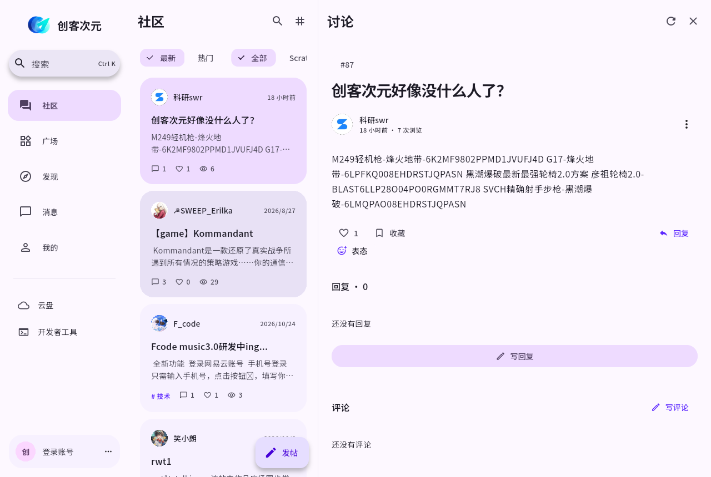
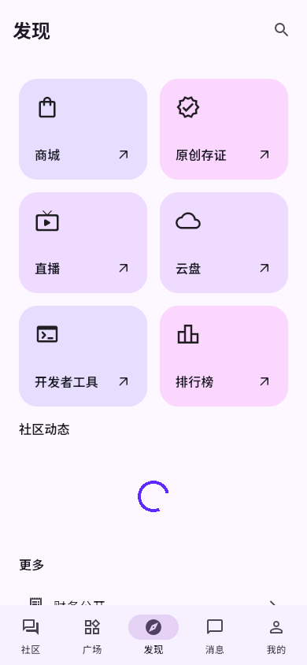

# 创客次元

基于 Flutter 的创客次元社区客户端，应用 ID 为 `xyz.ctspace.forum`，采用 Apache 2.0 许可证。

中文 Material You 界面，支持浅色、深色、系统主题、动态取色与自选主题色。手机使用底部导航，平板和桌面使用侧栏；桌面讨论与聊天支持双栏。交互包含强调曲线转场、列表入场、按压反馈和弹簧点赞，并遵循系统的「减少动态效果」设置。

| 桌面讨论 | 手机发现 |
| --- | --- |
|  |  |

已接入讨论、回复、评论、投票、表态、收藏、话题、作品与版本、扩展、富文本和 Markdown 草稿、用户关注与搜索、签到、通知、私信与群聊、积分互动、云盘、API Key、云变量、商城订单、地址、原创存证、直播互动、客服、素材、小游戏和个人装扮。具体实现范围、网页补充入口与接口限制见 [功能覆盖表](docs/FEATURES.md)。

## 运行

使用 Flutter **3.47.8 stable / Dart 3.13.7**。工程依赖 Flutter 3.44 及以上版本，建议使用上述已验证版本。

```bash
flutter pub get
flutter run -d linux
# 在其他宿主机或设备上：
flutter run -d macos
flutter run -d windows
flutter run -d android
flutter run -d ios
```

Linux 构建需要 GTK 3、libsecret 等依赖；登录时需要可用的系统密钥环。Windows 需要 Visual Studio C++ 桌面工具链，Apple 平台需要 macOS、Xcode 和 CocoaPods。完整命令、签名及运行依赖见 [构建指南](docs/BUILDING.md)。

默认连接 `https://forum.ctspace.xyz/api`，页面直接读取接口数据。可通过编译参数切换兼容的测试服务：

```bash
flutter run -d linux --dart-define=API_BASE_URL=https://your-host.example/api
```

作品与 HTML 游戏通过官方网页播放器运行；直播使用官网播放，聊天、问答和抽奖在原生界面操作。Android、iOS、macOS 可使用应用内 WebView；Windows、Linux 的补充网页交给系统浏览器。网页会话与原生登录会话分别管理。

## 验证

```bash
dart format --output=none --set-exit-if-changed lib test
flutter analyze
flutter test
```

测试覆盖认证与密钥存储、PoW、鉴权边界、写请求不自动重试、消息乱序与重连补取、富文本转换、草稿写入与退出保存、手机和桌面导航、大字号和减少动画。测试使用模拟传输，不会向生产站点发帖、发送消息或下单。

[验证记录](docs/VALIDATION.md) 区分了本机完成的检查与尚待其他宿主机执行的检查。[自动检查](.github/workflows/flutter.yml) 在提交和 PR 时执行检查；[手动打包](.github/workflows/build.yml) 仅通过 `workflow_dispatch` 触发。推送仓库后，在 Actions →「手动构建五端安装包」→ Run workflow 运行，五端产物上传到 Artifacts，保留 **3 天**，其中 iOS 为未签名 `.ipa`。

## 工程

- `lib/core/`：网络、会话、存储、数据解析、消息同步、Markdown 转换。
- `lib/features/`：按功能组织的原生页面。
- `lib/ui/`：主题、响应式导航、共享组件和平台能力。
- `test/`：单元与界面测试。
- `docs/API.md`：提供的 API 文档；[接口差异](docs/API_NOTES.md) 记录实际适配依据。

仓库已从初始化开始按功能提交。应用、字体及第三方依赖许可见 [LICENSE](LICENSE)、[NOTICE](NOTICE) 和应用中的「设置 → 开源许可」。
